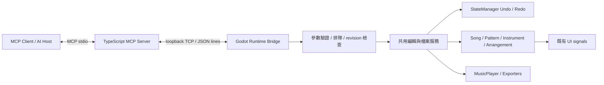

# Bosca Ceoil Blue MCP 擴充設計與實作計畫

日期：2026-10-12（Asia/Taipei）
狀態：設計完成，實作尚未開始。本文所有未勾選任務均為後續工作。
基準：`main`，`4b6b5c6`（3.2-dev）；規劃前工作樹乾淨。
目標專案：`C:\Users\guguc\GitHub\boscaceoil-blue`。

## 1. 目標、範圍與完成定義

將 MCP（Model Context Protocol）作為外部 AI 操作 Bosca Ceoil Blue 的介面，讓使用者能以自然語言讀取目前歌曲、建立音符與樂器、安排段落、試聽、復原及輸出檔案。AI client 負責推理與生成音樂資料，Bosca 負責驗證、編輯、播放與儲存；不在應用程式內嵌模型或 API 金鑰。

採用 **TypeScript MCP server（stdio）＋ Godot runtime 本機 TCP bridge ＋共用編輯服務**。第一版操作已啟動的桌面程式，不以模擬滑鼠點擊或離線改寫 `.ceol` 作為主要操作方式。

### 1.1 分階段交付

| 階段 | 交付能力 | 完成門檻 |
| --- | --- | --- |
| M0：技術驗證 | Godot 4.3／GDSiON 啟動、stdio client 連線、本機 bridge ping | 真實桌面 runtime 可被 MCP client 查詢，版本相容性已記錄 |
| M1：唯讀 | 連線狀態、歌曲摘要、音色目錄、pattern、編曲 | 查詢結果與 UI／模型一致，無歌曲變更 |
| M2：可編曲 MVP | 樂器、pattern、音符、編曲、播放、Undo/Redo、CEOL 儲存 | 可在空白歌曲建立 8 個 timeline bars、2 個聲部的 loop，試聽、復原、儲存重開 |
| M3：完整首版 | WAV／MIDI 匯出、既有 CEOL 開啟、安全控制、CI、安裝文件 | 真實 client 端到端測試及桌面打包通過 |
| 後續 | MIDI 匯入、MML／XM 匯出、進階濾波錄製、跨工具交易、遠端服務 | 另立範圍，不阻擋 M3 |

首版平台：Windows 優先，Linux／macOS 作桌面相容驗證；Web 不提供 TCP bridge，原本 Web 功能需繼續可匯出。第一版不包含公開 HTTP endpoint、OAuth、多使用者協作、自動啟動／關閉使用者程式、任意 GDScript 執行或整個檔案系統瀏覽。

### 1.2 使用情境與驗收故事

1. 「看看現在這首歌」：回傳 BPM、步數、樂器、pattern 數、編曲與播放位置，預設不傳所有音符。
2. 「加入鋼琴旋律與鼓」：先查音色和鼓組映射，建立樂器／pattern，以批次音符工具寫入，畫面即時更新。
3. 「把這段重複八次」：一次編曲操作放置八個格子，Ctrl+Z 一次完整復原。
4. 「把速度改為 100」：只改 BPM，播放端同步更新，不破壞音符。
5. 「儲存並匯出」：在使用者設定的資料夾寫入 CEOL，再輸出 WAV／MIDI；失敗有具體錯誤，不把 job 已建立當作匯出成功。

## 2. 專案現況與實際整合點

以下是已閱讀的程式碼事實；新增檔案、工具與限制則是本計畫的設計決策。

| 現況／依據 | 對 MCP 的影響 |
| --- | --- |
| `project.godot`：Godot 4.3，唯一 autoload 為 `globals/Controller.gd`；`Main.tscn` 是主場景 | bridge 必須存在於執行中的應用程式，不是只能在 Godot Editor 使用的 EditorPlugin |
| `.github/workflows/export-project.yml`：Godot `4.3.0-stable`、GDSiON `0.7-beta8` | 首版沿用，不把引擎升級混入 MCP 工作 |
| 本次 checkout 沒有 `bin/`；README 要求另外下載 GDSiON | 尚未證實本機可啟動或 headless 合成；P0 必須先補齊依賴並實測 |
| `Controller.gd` 管理目前歌曲、pattern／樂器選擇、信號、播放與各 manager | 只新增必要服務掛接；不把全部協定邏輯塞入 Controller |
| `objects/Song.gd`：最多 16 樂器、4096 patterns、pattern size 1–32、BPM 10–450 | schema 需與 runtime 限制一致，超限直接拒絕，不依賴 setter 靜默截斷 |
| `objects/Pattern.gd`：音符是 `Vector3i(value, position, length)`；每 pattern 128 notes | 外部用 JSON DTO；不可將 Godot Resource 或 Vector 型別直接暴露 |
| `Arrangement.gd`：1000 timeline bars × 8 channels；空格是 `-1`，loop end 不包含尾端 | API 使用零起算，loop 使用 `[start, end)`；不能把 timeline bar 當成固定四拍小節 |
| `StateManager.gd`：40 筆歷史、0.5 秒合併、Callable do/undo | 所有編曲變更走相同歷史，MCP 批次不得意外與 UI 連續輸入合併 |
| `gui/views/note_map/NoteMap.gd` 直接組 StateChange；其他參數編輯散在 views | 抽出與 MCP 共用的 domain commands，逐項遷移 UI，避免兩套行為 |
| `Controller.set_current_song()` 清除歷史、重設 driver 並開始播放 | new/open 要新增可控制 autoplay 的入口；MCP 預設不突然發聲 |
| `IOManager.gd` 的存取／匯出入口多會彈視窗；WAV 使用 driver callback | 抽出不需對話框、可回傳結果的服務，WAV 採背景 job |
| WAV 現行流程改動 `arrangement` loop、鎖住編輯 | MCP 匯出需保存並恢復 loop／播放位置，成功與失敗都解除鎖定 |
| `SongSaver.save()` 會改 `filename`／format；`FileWrapper` 直接寫入 | 安全儲存要暫存檔＋原子替換，成功後才更新正式路徑／clean 狀態 |
| `SongLoader.gd` 支援格式 1／2／3，仍有載入後驗證 TODO | 新 MCP open 不能只把 load 非 null 當作有效歌曲 |
| 既有 PR CI 主要匯出應用與建置文件；未找到專用 domain 自動測試套件 | 新增測試入口，不能把 workflow 名稱中的 Test 當作已有行為測試 |

沒有找到適用的 `AGENTS.md` 或既有 `plan.md`。本次僅新增本文件，不安裝套件、不變更應用行為。

## 3. 架構設計與選型



### 3.1 責任界線

- MCP server：MCP SDK、工具／資源登錄、JSON schema、stdio、bridge client、timeout、結果包裝。stdout 僅協定訊息，診斷寫 stderr。
- Bridge：只接受本機、認證、封包組裝、白名單命令路由、主執行緒排隊、結果回傳；不自行實作完整 MCP。
- 編輯服務：以實際模型驗證索引與容量、建立 StateChange、更新音符索引、發送正確 signals、維持 UI 和音訊一致。
- 檔案服務：只使用 Godot 現有 loader/saver/exporters，集中路徑與覆寫規則，不在 TypeScript 另做 CEOL parser。
- UI：開關、連線資訊、模式、授權資料夾、最近操作／錯誤；不向一般使用者展示 RPC payload。

### 3.2 技術決策

| 決策 | 理由／替代方案 |
| --- | --- |
| 外部 TypeScript server | 使用官方 SDK 處理 MCP，避免在 GDScript 手寫協定與把 Godot 日誌混進 stdio |
| MCP stdio | 配合本機 client 啟動 subprocess；不需要開放網路 HTTP 服務 |
| 私有 loopback TCP + 換行 JSON | Godot 4.3 內建 TCPServer 可用；Node 可用內建 net，降低額外依賴。這是內部協定，不宣稱是 MCP transport |
| 預設連接埠 37641，可配置 | 被占用就清楚報錯，首版不掃描或自動連到未知實例；每個實例用獨立 port／token |
| UI 與 MCP 共用編輯服務 | 保留既有 Undo 和信號語意，避免 UI 與自動化各自改資料 |
| 索引＋song_id＋revision | 首版不更改 CEOL 格式加入永久 UUID；在刪除／重排後以 revision 避免寫到錯誤索引 |
| 分工具批次，暫不做跨工具大交易 | `notes_set`／`arrangement_set` 各自原子；完整歌曲生成可逐步檢查，減少全面重構 |

官方 TypeScript SDK v2 文件目前標示為 stable，對應 MCP 2026-07-28；P0 以該線為候選，固定實測成功的精確套件版、Node 版本與 lockfile。目標 client 若只支援較舊協定，先驗證官方相容層；必要時以獨立相容入口選用 v1，不混用兩代 import/API。版本資料依 [官方 SDK](https://ts.sdk.modelcontextprotocol.io/v2/)；內部 TCP 可行性依 [Godot 4.3 TCPServer](https://docs.godotengine.org/en/4.3/classes/class_tcpserver.html)。不預先保證所有 MCP hosts 相容。

## 4. 對外資料契約

### 4.1 索引、音樂單位與驗證

- `song_id`：每次 new/open 產生新的 session UUID；不得以 filename 當 ID。
- `revision`：歌曲編輯狀態版本，任何有效 UI／MCP 編輯及 Undo/Redo 都遞增，Undo 不把版本倒退。存檔狀態變更也要反映，以便防止過期的替換／dirty 判斷。播放 tick 不遞增。
- `pattern_index`、`instrument_index`、`channel`、`bar`、`position` 一律零起算；所有寫入必帶 `song_id` 與 `expected_revision`，new 的無歌曲情境另以明確 null 表示。
- 拒絕未知欄位、非整數、NaN／Infinity、負索引、超出實際陣列長度的引用；先驗證再變更，不能交由 Godot setter 自動修正後回報成功。
- `position` 是 sequencer step，範圍 `0..pattern_size-1`。`length` 是 step 數，首版限制 `1..128`，允許跨 pattern 尾端延音，須以 fixture 驗證原有播放行為。
- MusicPlayer 中 `NOTE_LENGTH * BEATS_PER_NOTE = 0.25`，因此無 swing 時一 step 為四分之一拍；`bar_size` 只控制視覺分組。16 steps 通常是四拍，但 pattern size 可變，不能固定假設每個 timeline bar 都是 4/4。
- 旋律音符 `pitch` 使用實際音高值（60 為 middle C）；首版接受 0–103 作為明確 API 邊界，P0 以 UI 與 key transposition 邊界 fixture 確認。此邊界是 MCP 首版政策，不聲稱 `add_note()` 已完整 enforce。既有超出政策的音符仍能讀取。
- 鼓音符用 `drum_index`，依該 drumkit catalog 驗證；`pitch` 與 `drum_index` 互斥。不得直接把 MIDI 鼓音符編號當鼓組陣列索引。
- 單一音符沒有獨立 velocity 欄位；首版調整 instrument volume（0–256）。filter cutoff 0–128、resonance 0–9。
- 每 pattern 不超過 128 notes，首版拒絕同音高／鼓索引且同起點的重複資料；不同起點的延音重疊依既有播放器規則，fixture 明訂，不能靜默丟音符。
- Key／scale 用目錄值。既有 change_scale／change_instrument 可能移除音符：首版只容許不丟資料的更新；有損變更回 `WOULD_DROP_NOTES`，讓 client 明確重寫 notes 後再操作。
- Loop：`0 <= start < end <= timeline_length <= 1000`；channel 0–7。MCP 空格用 `null`，bridge 轉成 `-1`；寫到尾端時更新 timeline_length，清除尾端是否縮短要由 `trim` 明確指定（預設 false）。

### 4.2 建議工具清單

表格的參數省略共用 `instance_id`；歌曲寫入省略 `song_id`、`expected_revision`、`operation_id`。所有 schema 必須描述單位、範圍、預設值與回傳欄位。

| 工具 | 主要輸入 | 回傳／行為 | 階段 |
| --- | --- | --- | --- |
| `bosca_status` | 無 | app／bridge 版本、instance_id、模式、busy、song_id、revision、播放狀態、實際 limits | M1 |
| `bosca_song_get` | `detail: summary` | 歌曲設定、dirty、各集合數量、目前選取項，不含全部音符 | M1 |
| `bosca_catalog_list` | `kind: voices/scales/effects`、filter、cursor、limit | 可用且穩定識別的目錄值、鼓音符映射；limit 預設 50，最大 200 | M1 |
| `bosca_pattern_get` | pattern_index | 指定 pattern、音符、key／scale、instrument_index | M1 |
| `bosca_arrangement_get` | start、count | 指定 timeline 範圍；count 預設 16，最大 128 | M1 |
| `bosca_song_new` | 替換前 revision、`discard_unsaved=false` | 新 song_id，預設不播放；dirty 且無明確 discard 時拒絕 | M2 |
| `bosca_song_update` | bpm、swing 等明確欄位 | 修改摘要與新 revision；pattern_size 縮減可能截資料時先拒絕 | M2 |
| `bosca_instrument_create` | catalog voice_id | instrument_index 與新 revision；上限 16 | M2 |
| `bosca_instrument_update` | instrument_index、volume／filter／voice_id | 更新結果；更換類型有損時拒絕 | M2 |
| `bosca_pattern_create` | instrument_index、key、scale | 新 pattern_index 與 revision | M2 |
| `bosca_pattern_clone` | pattern_index | 新索引；依原 clone 行為複製 notes／錄製濾波資料 | M2 |
| `bosca_pattern_delete` | pattern_index | 被影響的編曲格與索引對照；一次 Undo 完整恢復 | M2 |
| `bosca_notes_set` | pattern_index、mode: replace/append/remove、notes | 全批次驗證、單次 Undo；remove 以音高／鼓索引＋position 定位，找不到即失敗 | M2 |
| `bosca_arrangement_set` | cells: [{bar,channel,pattern_index或null}]、trim | 最多 256 cells／call，同格重複拒絕；整批原子 | M2 |
| `bosca_loop_set` | start、end | 更新 loop、合法播放位置與 revision | M2 |
| `bosca_playback_set` | action: play/pause/stop | runtime 播放狀態；這類操作不放編曲 Undo，但仍檢查 song_id／revision | M2 |
| `bosca_history_step` | action: undo/redo | 一次既有歷史操作、摘要、新 revision；空歷史回 NO_HISTORY | M2 |
| `bosca_song_save` | root_id、relative_path、overwrite=false | 經安全寫入的相對路徑、size、新 revision，成功後清 dirty | M2 |
| `bosca_song_open` | root_id、relative_path、discard_unsaved=false | 驗證成功後替換歌曲，回新 song_id，預設不播放 | M3 |
| `bosca_export_start` | format: wav/midi、root_id、relative_path、range、overwrite | job_id 與初始狀態；不立即聲稱完成 | M3 |
| `bosca_job_get` | job_id | queued/running/succeeded/failed/cancelled、結果與錯誤 | M3 |
| `bosca_job_cancel` | job_id | pending cancellation 或終態；driver 無安全取消路徑前不可宣告支援 | M3 |

M2 的 instrument 刪除、pattern metadata 修改、錄製濾波設定等若未列工具，就不對外宣告支援。先把可組成完整歌曲的核心流程做完，再補廣度。

### 4.3 Resources 與 prompts

首版提供唯讀 JSON resources：`bosca://status`、`bosca://song/current`、`bosca://song/current/pattern/{index}`、`bosca://catalog/voices`。內容與工具共用 DTO；pattern 資源附 song_id／revision，不能把同 URI 視為跨歌曲不變。目錄回應超出容量時改用分頁工具。

訂閱通知視 SDK／client 能力加上，沒有訂閱也必須可重新查詢；不將每個播放 tick 廣播出去。Prompts（例如「建立 loop」「變奏現有旋律」）延後，避免靠 prompt 補救未完成的工具契約。工具 schema／結果依 [MCP tools 官方規格](https://modelcontextprotocol.io/specification/2026-07-28/server/tools) 實作，業務錯誤用 SDK 對應的 tool error 格式，與協定錯誤分開。

### 4.4 操作例與結果

以下是工具 arguments 示意，不是完整 MCP wire message；最新 revision 必須取自前一步，不能寫死。

```json
{
  "instance_id": "app-session-uuid",
  "song_id": "song-session-uuid",
  "expected_revision": 12,
  "operation_id": "operation-uuid",
  "pattern_index": 0,
  "mode": "replace",
  "notes": [
    {"pitch": 60, "position": 0, "length": 2},
    {"pitch": 64, "position": 4, "length": 2},
    {"pitch": 67, "position": 8, "length": 4}
  ]
}
```

成功 DTO 至少含 `song_id`、`revision_before`、`revision_after`、`operation_id`、`changed`、`summary`。無變更不製造歷史或新 revision。錯誤 DTO 含 `code`、`message`、`retryable`、`details`（field／index／allowed_range／current_revision）。API 邊界錯誤不回內部 stack trace。

必要錯誤碼：`APP_NOT_CONNECTED`、`NOT_READY`、`AUTH_FAILED`、`READ_ONLY`、`NO_SONG`、`INVALID_ARGUMENT`、`NOT_FOUND`、`LIMIT_EXCEEDED`、`REVISION_CONFLICT`、`UNSAVED_CHANGES`、`WOULD_DROP_NOTES`、`APP_BUSY`、`NO_HISTORY`、`PATH_NOT_ALLOWED`、`FILE_EXISTS`、`IO_FAILED`、`EXPORT_FAILED`、`TIMEOUT`、`OUTCOME_UNKNOWN`、`UNSUPPORTED_VERSION`。

## 5. Bridge、交易與一致性

### 5.1 Bridge transport

1. 使用者在設定開啟 bridge；預設停用。只 listen `127.0.0.1`，port 可調，不接受任意 bind address。
2. 啟動建立 instance_id 和隨機 token；token 以使用者權限保護的設定檔交給 server，CLI 僅傳設定檔路徑。UI 可重建 token 並立即踢除舊連線；不能寫入 repo／日誌。
3. MCP server 根據明確設定連線；首包 `hello` 帶 token、bridge_version。回傳 instance_id、capabilities、limits、ready 狀態；在認證之前只允許 hello。
4. 首版僅一個已認證控制連線；第二個回 BUSY，避免兩個 hosts 交錯編輯。UI 仍可編輯，以 revision 防止過期呼叫。
5. 私有請求使用 `{id, method, params}`，回應 `{id, result}` 或 `{id, error}`；UTF-8 JSON，每行一包。正確處理分包、黏包、UTF-8 分段、partial write 與 buffer 上限。
6. 建議初始限額：單包 1 MiB、待處理佇列 32、認證 timeout 3 秒、普通 request 10 秒、idle ping 15 秒；limits 必須可測試且有壓力測試依據。
7. 在 Node `_process()` 非阻塞讀寫、每 frame 限制處理量；所有 Godot 模型／UI／SiON 操作在主執行緒，不能在 TCP thread 直接修改 Resource。
8. `Controller._ready()` 完成 driver 初始化且 `Main._ready()` 建立歌曲後才標 ready；啟動中回 NOT_READY。關閉 bridge 清理 sockets／佇列／timer，不關閉 Bosca。

### 5.2 命令提交與 Undo

1. 在執行當下再次檢查認證模式、instance_id、song_id、revision、busy，而非僅在入隊時檢查。
2. 不會 await 的短批次，先於暫存 DTO 計算全部結果，驗證容量、引用、有損變化和每一筆 notes／cells。
3. 驗證完成才建立 StateChange；整次 MCP 操作用獨立 accumulation_id／禁止 accumulation，不能串到 UI 0.5 秒合併區間。
4. 對受影響物件建立明確 before/after 資料，單次 commit 更新並發必要 signals；避免重複呼叫已自帶歷史的 Controller 方法形成巢狀紀錄。
5. `StateManager` 現在 undo 以正向順序呼叫 rollback，不是一般交易的反向順序。跨物件操作應使用單一 aggregate do/undo callback，內部明訂復原順序；不要為 MCP 未經回歸就全域反轉既有歷史。
6. 批次失敗不得留下前半段修改、dirty、redo 清空或卡住 `_pending_changes`；必要時新增顯式 abort API，並測試執行期失敗還原，不只測 schema 拒絕。
7. Pattern／instrument 刪除會牽涉索引重排、selection、arrangement、最少一個物件等不變條件；沿用並測試現有 Controller 處理，不只 remove_at。
8. Revision tracker 以一次 logical commit／undo／redo 為單位，稽核 UI 直接修改路徑；不能同時監聽多個 signal 導致一次改動遞增多次。過期 request 回衝突，client 重新讀取後才重算。

### 5.3 timeout、重送與執行結果不明

- 每個 mutation 帶 operation_id；bridge 在 session 內保留最近 256 筆／10 分鐘的結果與 payload hash。同 ID 同 payload 回原結果，同 ID 不同 payload 拒絕；去重判斷優先於舊 revision 檢查。
- 查詢可以重試；mutation timeout 不能用新 ID 自動重做。新增內部 operation status 查詢，同 ID 查不到且可能已提交時回 OUTCOME_UNKNOWN，要求重新讀狀態。
- 去重保證僅限保留窗口與相同 instance_id，重啟後不保證 exactly-once。已入隊但未執行可取消；已提交的編曲變更必須走 Undo，不能把取消假裝成回滾。
- 大型歌曲讀取分頁；新建 pattern、加入 notes、放入編曲是三次可復原操作，不宣稱整段 AI 對話只有一個 Undo。

## 6. 檔案、匯出與使用者控制

### 6.1 檔案存取

- 設定頁註冊可讀／可寫資料夾，server 使用 root_id＋relative_path，不提供任意本機檔案讀取工具。
- Godot 檔案服務是最終防線；拒絕絕對路徑、`..` 逃逸、UNC／device path、Windows alternate data streams，檢查副檔名及目標父目錄。
- 必須正規化實體路徑並處理 Windows junction／symlink／大小寫；若純 Godot 無法可靠辨識，首版限制只用應用建立的專用匯出資料夾並拒絕 reparse points，不能以字串 prefix 當安全邊界。此為 P0 必驗證項。
- `overwrite` 預設 false。寫入同目錄隨機暫存檔，close／確認完整後替換；平台不能原子 no-clobber 時要明確處理競爭。失敗保留原檔，不 mark_clean。
- 調整 SongSaver 的路徑／metadata 耦合，暫存路徑不可成為 current_song.filename；成功後才更新正式檔名與 clean。存檔中若允許編輯，僅在 revision 相符時清 dirty；首版可短暫鎖編輯簡化。
- Open 先在獨立物件解析／完整驗證，成功才切換 current_song；失敗不清掉原歌曲與歷史。new/open 對 dirty 歌曲預設拒絕，discard 由明確工具參數表示，不能等待隱藏對話框。

### 6.2 匯出工作

1. export_start 驗證路徑、格式、range、revision，建立 job；一次只執行一個匯出，其他匯出回 APP_BUSY。
2. 保存 loop、播放游標、播放／暫停狀態，暫停播放並鎖編輯；此時讀取／job 查詢可用，new/open/undo/播放切換拒絕。
3. WAV 沿用 MusicPlayer＋WavExporter；MIDI 沿用 MidiExporter。抽出對話框以外的正式方法，不讓 server 直接呼叫 `_confirmed` 私有 UI callbacks。
4. Job 狀態包含時間與錯誤；只有可計算時提供 progress，不能用假百分比。建議最大匯出時長預設 5 分鐘、可設定，限制 WAV 記憶體增長。
5. 寫入完成才 succeeded；失敗／取消移除該 job 暫存檔，恢復原 loop、游標及播放狀態，解除鎖定並斷開一次性 signals。
6. Driver 若無法立即取消，cancel 表示 cancellation_requested，等安全邊界停下再給 cancelled。若 GDSiON 無可靠取消，M3 前實作並驗證停止流程或明確不公開 cancel capability。
7. MCP client 斷線不丟失已開始 job；Bosca 繼續完成，server 重連後可查。程式關閉的匯出中斷留下可診斷狀態，不報成功。
8. 輸出回傳 root_id／relative_path／檔案大小／格式／range；大型 WAV 不 base64 塞入 tool response。音訊預覽 resource 可作後續增補。

### 6.3 設定與觀察性

新增「MCP 遠端控制（本機）」區塊：啟用開關、唯讀／允許編輯、port、連線狀態、root 設定、複製 client 設定、斷開連線。預設唯讀，使用者在 UI 開啟編輯模式；工具參數不能自行提升權限。

只記錄最近操作摘要、operation_id、duration、結果碼；token、完整歌曲、使用者完整路徑不寫診斷。限制日誌大小。Tool annotations 準確標示唯讀／破壞性／冪等性，但不能以 annotations 代替實際權限檢查。

## 7. 預計檔案配置

下列皆為提案名稱；實作前以既有命名風格調整，不必為一個方法建立一個類別。

```text
automation/
  AutomationBridge.gd        # Node：TCP、認證、主迴圈
  AutomationRouter.gd        # 命令白名單與結果
  SongQueryService.gd        # DTO、分頁、catalog
  SongEditService.gd         # 共用 domain commands、歷史
  SongFileService.gd         # 無對話框 I/O 與路徑政策
  ExportJobManager.gd        # 匯出生命週期
  AutomationRevision.gd     # song session、revision、去重結果
mcp/
  package.json
  package-lock.json
  tsconfig.json
  src/index.ts
  src/bridge-client.ts
  src/contracts.ts
  src/tools.ts
  src/resources.ts
  test/
tests/automation/
  runner.gd
  fixtures/
scripts/
  test-mcp.ps1
docs/mcp/
  README.md
  protocol.md
  troubleshooting.md
```

主要既有修改點：`globals/Controller.gd`、`globals/StateManager.gd`（只在必要時補 abort／事件）、`globals/SettingsManager.gd`、`globals/IOManager.gd`、對應 GUI views／settings UI、`io/SongSaver.gd`、`.gitignore`、CI。Controller 管理 bridge Node 生命週期；Web 以 feature guard 不建立 listener。新增 mcp Node 套件與測試資料需排除於 Godot 發行包，避免 node_modules／測試 fixtures 打包進遊戲資源。

## 8. 詳細任務拆解

估時為單一熟悉 Godot／TypeScript 的開發者投入日，含該任務測試，不是已驗證排程；GDSiON／client 相容性未知會增加工時。每項完成後在下方勾選並記錄 commit／驗證結果。

### P0：基線與可行性（2–3 日）

- [ ] **T01：重現開發與發行環境**（0.5–1 日，無依賴）
  1. 記錄 Git 基準、Godot／GDSiON 版本；依現有 setup-deps 方式準備 bin，不升級引擎。
  2. 啟動桌面，完成 UI 新增音符、播放、Undo、CEOL 存取、WAV/MIDI 匯出 smoke。
  3. 以專用 fixture 驗證 headless 模型測試是否能載入 Controller／GDSiON；若不能，分離測試場景，真實音訊保留桌面測試。
  4. 驗收：可重現命令、依賴版本、成功／受限項記錄在 docs/mcp；原版可運作。
- [ ] **T02：傳輸與契約 spike**（1–1.5 日，依 T01）
  1. 暫時 bridge ping、Node net client、MCP status tool 跑通；不接寫入。
  2. 使用一個實際目標 MCP client 驗證 SDK／協定相容性、stdio log 隔離與關閉行為，固定精確版本。
  3. 驗證長音、key 邊界、drum 映射、loop end、junction 路徑檢查、driver cancel 可行性。
  4. 驗收：確定 SDK 版本與 filesystem 邊界方案；無法解決的項目不得只留 TODO 後直接開放寫入。
- [ ] **T03：完成 contract fixtures**（0.5 日，依 T02）
  1. 定稿 DTO、tool schema、錯誤碼、operation_id／revision、limits。
  2. 建立合法／非法 JSON fixtures、預期結果、各工具副作用／Undo 表。
  3. 驗收：每個 M2 工具有正向、邊界及失敗案例，TS／Godot 共用資料樣本。

### P1：唯讀垂直切片（3–4 日）

- [ ] **T04：Runtime bridge**（1–1.5 日，依 T03）
  1. 建立 Node 生命週期、loopback listener、認證、hello、ready／busy、關閉清理。
  2. 實作 framing、buffer／queue 限額、每 frame 預算、partial read/write。
  3. 驗收：未認證／錯版本／超長包被拒絕；連線故障不崩潰、不影響一般 UI。
- [ ] **T05：唯讀服務與 resources**（1 日，依 T03）
  1. 從 Controller／VoiceManager 產生 summary、pattern、arrangement、catalog DTO。
  2. 加入分頁、limits、drum mapping、song_id／revision 基線。
  3. 驗收：空白與多 pattern fixtures 與 UI 相符；沒有 dirty／歷史變動。
- [ ] **T06：MCP package 與真 client 驗證**（1–1.5 日，依 T04/T05）
  1. 完成 TypeScript 建置、SDK tool/resource 登錄、bridge timeout/error mapping。
  2. 建立 host-neutral command/args 設定例與實際 client 範例，處理 Windows 空白路徑。
  3. 驗收：實際 client 可列出並呼叫所有 M1 tools；Bosca 未啟動時回可理解的 APP_NOT_CONNECTED。

### P2：共用編輯核心（5–7 日）

- [ ] **T07：revision 與命令交易基礎**（1–1.5 日，依 T06）
  1. 稽核 UI 編輯來源，接入一次 logical operation 一次 revision。
  2. 實作 validate-before-commit、aggregate before/after、abort、operation_id cache。
  3. 驗收：UI 和 MCP 交錯、Undo／Redo、timeout 重送不覆寫新資料、不重複執行。
- [ ] **T08：歌曲參數、樂器、pattern 操作**（1.5–2 日，依 T07）
  1. 抽出 create/update/clone/delete，保留現有 signals 與最少一個物件的規則。
  2. 加入無 autoplay 的 new 接口；有損 scale／樂器切換先拒絕。
  3. 驗收：pattern 刪除重排後編曲／selection 正確，一次 Undo 回到完全一致狀態；16／4096 上限。
- [ ] **T09：音符批次與 UI 共用**（1–1.5 日，依 T07/T08）
  1. 實作 replace/append/remove、melodic/drum 驗證、snapshot rollback。
  2. 將 NoteMap 對應 UI 操作遷入共用命令，保留原本拖曳操作體驗。
  3. 驗收：128／129 notes、重複／缺失音符、長音、錯 drum_index；任一非法項使整批零改動。
- [ ] **T10：編曲、loop、播放與歷史**（1.5–2 日，依 T08/T09）
  1. 建立 cells 批次、null 清除、timeline trim、loop 半開區間及安全游標。
  2. 封裝播放／暫停／停止、Undo／Redo，加入 busy／revision 保護。
  3. 驗收：8 channels、bar 999／1000 邊界、最後 pattern／樂器相關引用、256 cells 單次 Undo；手動操作回歸正常。

### P3：儲存與匯出（4–6 日）

- [ ] **T11：無對話框安全 CEOL 儲存**（1–1.5 日，依 T10/T02）
  1. 抽出 root policy、暫存寫入與替換、metadata/dirty 更新。
  2. 實作檔案存在、唯讀資料夾、磁碟錯誤、檔名副檔名等錯誤。
  3. 驗收：M2 8-bar loop 儲存重開可播放；失敗不毀原檔、不清 dirty、不留下暫存 filename。
- [ ] **T12：CEOL 開啟與完整驗證**（1 日，依 T11）
  1. 解析到獨立 Song；限制大小／數量，檢查 pattern／instrument 引用、notes、loop。
  2. 修正必要的錯誤傳遞，使惡意／截斷輸入不越界；確認 discard 與 no-autoplay。
  3. 驗收：v1／v2／v3 fixtures 能開，壞檔不影響目前歌曲／歷史。
- [ ] **T13：WAV／MIDI jobs**（1.5–2.5 日，依 T11/T12）
  1. 從 IOManager 抽出 exporter service；新增 job state、status、忙碌鎖與上限。
  2. 實作成功／失敗／取消／斷線恢復及暫存檔清理；完成 driver cancellation gate。
  3. 驗收：輸出檔可解析、非空、loop range 正確；WAV 成功與故障都恢復 UI／播放／loop，不永久 busy。
- [ ] **T14：設定頁與診斷**（0.5–1 日，依 T04/T11）
  1. 加入開關、唯讀／編輯模式、root、port、token reset、連線狀態。
  2. 提供可複製 client 設定與精簡操作記錄，重建 token 立即失效。
  3. 驗收：停用時無 listener；無 GUI 操作能繞過 root 與唯讀模式；原設定可相容載入。

### P4：整合、回歸與發行（3–5 日）

- [ ] **T15：自動化測試與 CI**（1–2 日，依 T06 起持續建立，完成依 T13/T14）
  1. MCP unit／transport tests 使用 mock bridge；Godot domain tests 使用真模型與 StateManager。
  2. 新增專用 smoke test scene，避免主場景歡迎視窗或音效裝置阻塞 headless。
  3. CI 加入 npm ci、typecheck、unit、Godot integration；保留現有 desktop/Web export jobs。
  4. 驗收：任一契約或 Undo 回歸都使 CI 失敗；缺 GDSiON 明確報失敗或獨立 skip 原因，不假成功。
- [ ] **T16：真實端到端與效能**（1–1.5 日，依 T15）
  1. 真 MCP client 跑 M1/M2/M3 故事，包含 UI 中途修改造成 revision conflict。
  2. 注入半包／斷線／連線占用／失敗寫檔／取消匯出，確認回復。
  3. 量測 128 notes／256 cells、歌曲摘要與大量 catalog 分頁；在記錄規格的參考機以一般控制操作 p95 <250ms 為初始目標，觀察播放無新增爆音。匯出另計，不把目標寫成已達成。
  4. 驗收：Windows 真桌面通過；Linux／macOS 測試記錄與支援矩陣明確，不將模擬成功當實機成功。
- [ ] **T17：文件與打包**（1–1.5 日，依 T16）
  1. docs/mcp 說明安裝、Node／SDK 精確版本、啟動 app、設定 root、連線、完整工作範例與排錯。
  2. Godot export 排除 mcp/node_modules、token、tests；獨立打包已編譯 MCP server＋依賴說明，發行版本對齊 bridge_version。
  3. README 加短入口連結，工具 schema 的詳細描述以 protocol 文件為單一來源。
  4. 驗收：乾淨環境按文件能完成故事；停止 MCP client 不終止 Bosca，Web 版仍正常匯出與啟動。

總投入初估 **17–25 個開發日**，另預留約 20% 相容性緩衝。若只有短期投入，先交 M1，接著以 T11 完成 M2，不提前承諾 WAV 可 headless。T15 測試隨各功能同步建立，P4 集中做完整回歸。

依賴主線：`T01 → T02 → T03 → T04/T05 → T06 → T07 → T08 → T09 → T10 → T11 → T12 → T13 → T15/T16 → T17`；T14 於 T11 後整合。每個任務以可獨立回滾的 commit 交付，建議前綴 `feat(mcp)`／`refactor(automation)`／`test(mcp)`／`docs(mcp)`。

## 9. 測試矩陣與執行入口

| 層次 | 必測項 | 成功條件 |
| --- | --- | --- |
| Contract | unknown fields、int 範圍、索引、分頁、schema 版本 | TS 與 Godot 相同 fixture 結果一致 |
| Bridge | 分包黏包、UTF-8、partial write、認證、超長包、queue、EOF | 不崩潰、不越權、不無限 buffer |
| Domain | notes、drums、delete/reindex、loop、dirty、Undo/Redo | 正確模型與 signals；批次失敗完全不變 |
| Concurrency | UI 先修改、雙 client、重複 operation_id、timeout、重啟 | 衝突可診斷，無靜默重複寫入 |
| Files | traversal、junction、錯誤副檔名、覆寫、截斷檔、寫入失敗 | 僅 root 內 I/O，失敗保留原檔與歌曲 |
| Export | 正常、範圍、取消、磁碟失敗、斷線、重連 | 終態準確，解除鎖定、恢復 loop/transport |
| Product | MCP 編輯→UI 顯示→UI Undo→MCP 讀取 | 人與 AI 操作相同歌曲狀態 |
| Packaging | 停用、Web、Windows 路徑、token 排除 | 未使用 MCP 者不增加 Node 執行需求 |

以下命令是**待 T15 建立的正式入口**，目前並不存在；文件不可將它們描述成已可執行：

```powershell
npm --prefix mcp ci
npm --prefix mcp run typecheck
npm --prefix mcp run test:unit
npm --prefix mcp run build
./scripts/test-mcp.ps1 -Suite Godot
./scripts/test-mcp.ps1 -Suite Integration
./scripts/test-mcp.ps1 -Suite All
```

PowerShell wrapper 接受明確 Godot 路徑並傳遞非零退出碼；底層 Godot runner／npm scripts 可供 Linux／macOS CI 重用。既有匯出命令以 `.github/actions/export-godot-project/action.yml` 為準：`godot --headless --path ... --import` 及 `--export-release`。目前 import 步驟有 continue-on-error，新測試不能因而吞掉腳本解析錯誤。

測試 fixture 至少包含：空白歌曲、鋼琴＋鼓 8 bars、128 notes 滿載、16 instruments、跨 pattern 長音、4096 patterns／1000 bars 邊界、v1/v2/v3 CEOL、截斷 CEOL、含非法引用的歌曲。優先程式生成大型 fixture，避免不必要的巨大二進位檔。

## 10. 主要風險、退出條件與完成清單

| 風險 | 處理／退出條件 |
| --- | --- |
| 編輯行為分散，抽離破壞既有 UX | 每次遷移只涵蓋工具對應操作；用 UI 與 MCP 雙路徑回歸，不先全面重構 |
| SiON Resource 不可直接深拷貝 | snapshot 儲存可序列化 domain 值，voice 透過 catalog 重建；不盲用 Resource.duplicate |
| Undo 順序與 indexed references | aggregate callback、明確復原引用／selection、刪除後連續 undo/redo 測試 |
| 原有 dirty 無「回到已存版本即 clean」能力 | 首版保留現有保守語意，Undo 仍 dirty；不可承諾已修復整套 saved-state tracking |
| GDSiON 無法 headless 合成／取消 | P0 先驗證；模型測試獨立、音訊使用桌面，cancel capability 以實測為準 |
| Godot 路徑 API 無法安全辨識 junction | 專用資料夾限制或補足最小平台適配，未完成前不可開放任意 roots |
| SDK/client 版本不一致 | 固定版本與實測 client；使用官方相容方案，避免混用 v1/v2 |
| 匯出阻塞或 WAV 記憶體暴增 | 非同步 jobs、長度／記憶體限制、失敗 cleanup、性能量測 |
| 重送導致重複編曲 | operation_id 快取、revision、OUTCOME_UNKNOWN 路徑，不宣稱跨重啟 exactly-once |

M3 發行前逐項完成：

- [ ] 已驗證的 MCP client 可以連接已開啟 Bosca，完整執行 M1/M2/M3 故事。
- [ ] AI 的每次編曲 mutation 都能對應正確歷史，UI／MCP 相互看到最新資料。
- [ ] 索引、容量、鼓組、有損操作、路徑／覆寫均有負面案例。
- [ ] 儲存重開語意一致；WAV／MIDI 實際可用，不只檢查 file exists。
- [ ] 失敗、取消、斷線不毀歌曲、不永久鎖住 UI；錯誤回傳可恢復資訊。
- [ ] 停用 bridge 時沒有 listener；唯讀、token reset 與資料夾限制有效。
- [ ] CI、桌面 smoke、既有 Web 匯出通過，版本支援矩陣與限制已寫明。
- [ ] README／安裝／工具契約／排錯文件一致，plan 任務附完成依據。

## 11. 參考資料與版本查核

專案事實以基準 commit 的 `project.godot`、README、`objects/`、`globals/`、`io/`、NoteMap 及 `.github/` 為準。外部資料於 2026-10-12 查閱：

- [MCP TypeScript SDK v2 官方文件](https://ts.sdk.modelcontextprotocol.io/v2/)：SDK 版本線、官方 API 與相容性入口。
- [MCP 2026-07-28 Tools](https://modelcontextprotocol.io/specification/2026-07-28/server/tools)：工具契約與結果格式。
- [MCP 2026-07-28 Transports](https://github.com/modelcontextprotocol/modelcontextprotocol/blob/main/docs/specification/2026-07-28/basic/transports/index.mdx)：外部 MCP transport 依據。
- [Godot 4.3 TCPServer](https://docs.godotengine.org/en/4.3/classes/class_tcpserver.html)：runtime 本機 TCP 可用介面。

外部版本會變動；實作開始時重查並將實際測試成功版本寫入 lockfile 和文件。這份計畫尚未執行應用 build、音訊測試或 MCP 互通測試，不能把方案中的目標當成既有功能。
